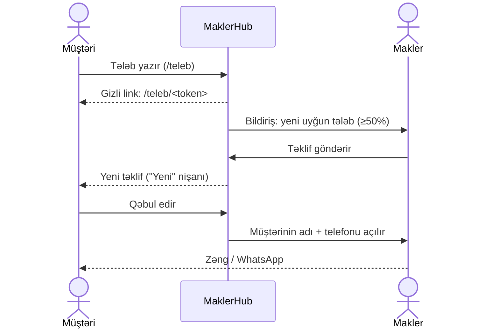
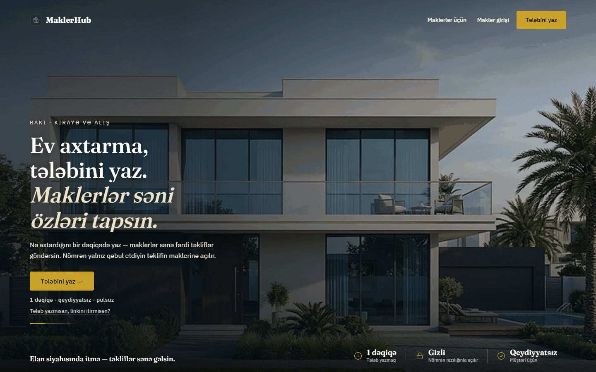
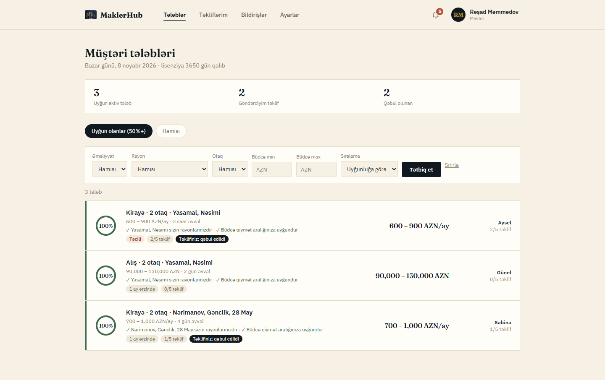
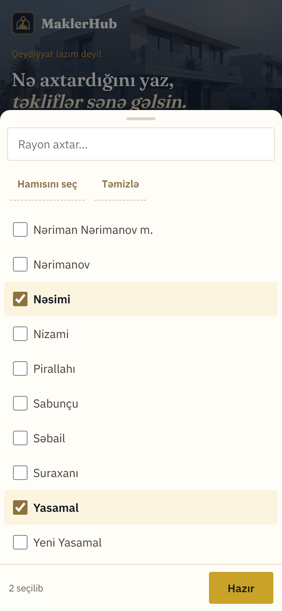
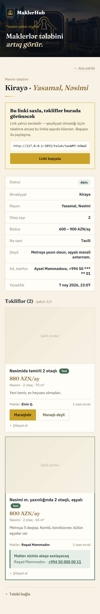
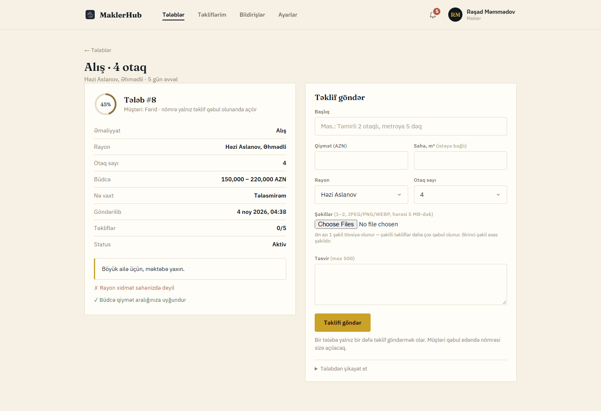
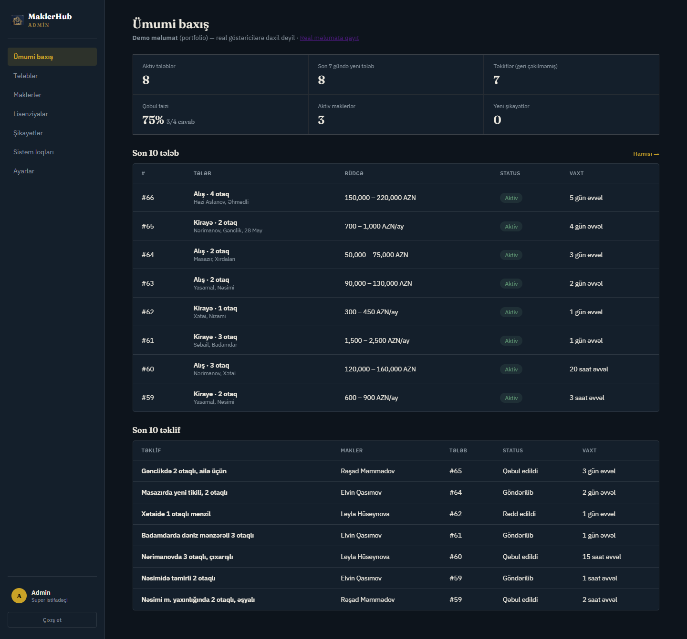
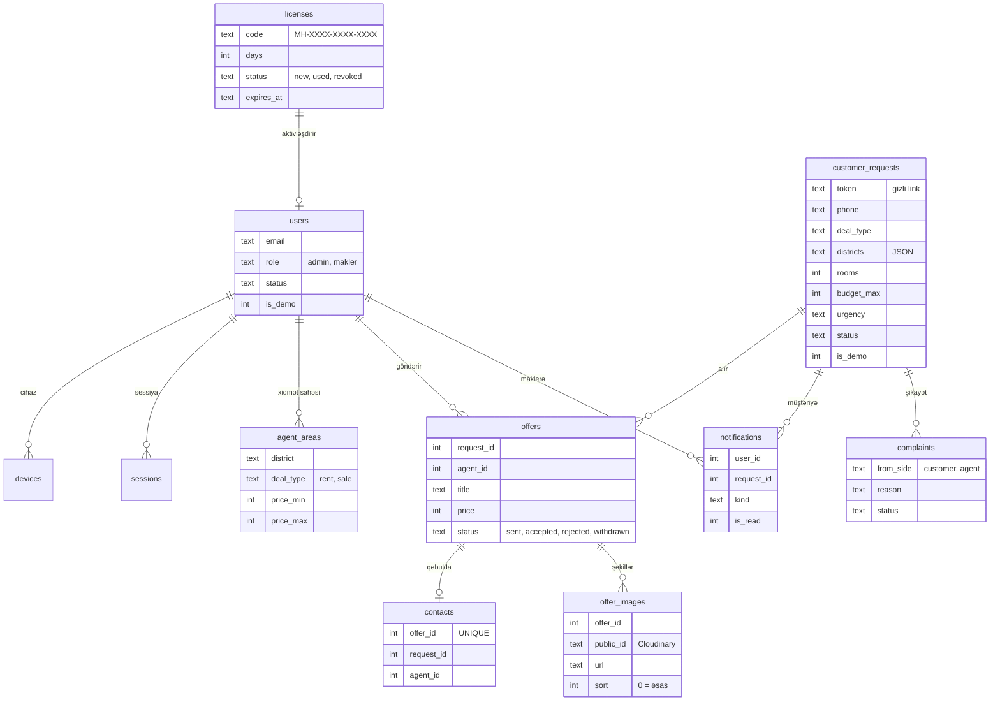

<p align="center"></p>

# MaklerHub

**Siz ev axtarmırsınız — maklerlər sizin üçün axtarır.**

MaklerHub Bakı üçün "tərs" daşınmaz əmlak platformasıdır: müştəri nə istədiyini bir dəfə yazır, lisenziyalı
maklerlər uyğun evləri ona özləri təklif edir. Müştərinin nömrəsi heç kimə görünmür — yalnız təklifi qəbul etdiyi
maklerə açılır.

🔗 **Canlı versiya:** https://maklerhub.onrender.com
👤 **Demo makler girişi:** `demo1@maklerhub.az` / `Demo12345` (https://maklerhub.onrender.com/giris)

> Sayt pulsuz hostinqdədir (Render + Neon): bir müddət boş qalandan sonra ilk açılış 30–60 saniyə çəkə bilər.
> Demo məlumatlar realdan tam ayrıdır: demo makler yalnız demo tələbləri görür, demo hesabda ayarlar dəyişdirilmir.

---

## Problem

Bakıda ev axtaran adam bu gün elan saytlarında saatlarla eyni şəkilləri, köhnəlmiş və "yem" elanları vərəqləyir,
nömrəsini onlarla maklerə verir, sonra günlərlə zəng qəbul edir. Makler isə müştəri tapmaq üçün yüzlərlə elan
yerləşdirir və "ev hələ var?" zənglərinə cavab verir. Hər iki tərəf vaxt itirir, nömrə isə nəzarətsiz yayılır.

## Həll

MaklerHub axını tərsinə çevirir:

1. **Müştəri** qeydiyyatsız, 1 dəqiqəlik forma ilə tələbini yazır: kirayə/alış, bir və ya bir neçə rayon (və ya "bütün Bakı"), otaq sayı, büdcə,
   təcililik. Ona gizli link verilir — "Mənim tələbim" səhifəsi.
2. **Maklerlər** kabinetdə öz xidmət sahələrinə uyğun tələbləri uyğunluq faizi ilə görür və konkret evi təklif
   edir (başlıq, qiymət, rayon, otaq, sahə, 1–5 şəkil, təsvir). Bir tələbə ən çox 5 təklif gəlir.
3. **Müştəri** təklifləri öz səhifəsində müqayisə edir: "Maraqlıdır" və ya "Maraqlı deyil".
4. Qəbul olunan təklifin **maklerinə müştərinin adı və nömrəsi açılır** (zəng və WhatsApp linki). Digər
   maklerlər nömrəni heç vaxt görmür.

## Necə işləyir



| | Bina.az / Tap.az (elan saytları) | MaklerHub |
|---|---|---|
| Kim kimi axtarır | Müştəri elanları vərəqləyir | Maklerlər müştərinin tələbinə gəlir |
| Müştərinin nömrəsi | Müştəri özü onlarla nömrəyə zəng edir, nömrəsi hamıda qalır | Yalnız qəbul etdiyi maklerə açılır |
| Uyğunluq | Filtrlər; nəticədə çoxlu təkrar elan | Hər tələb üçün rayon + büdcə üzrə uyğunluq faizi |
| Spam | Elan yerləşdirmək asandır | Makler yalnız lisenziya kodu ilə; tələbə 5 təklif limiti, şikayət sistemi |
| Müştəri üçün qeydiyyat | Elan üçün lazım ola bilər | Yoxdur — gizli link kifayətdir |
| Kimin üçün | Hamı (satıcı, makler, alıcı) | Ev axtaran müştəri ↔ peşəkar makler |

## Əsas funksiyalar

- **Uyğunluq mühərriki** (`maklerhub/matching.py`) — təmiz funksiyalar: əvvəl qapı (makler bu əməliyyat növü ilə
  işləyirmi), sonra **rayon 55 bal + büdcə 45 bal** × kəsişmə nisbəti. Müştəri minimum büdcə yazmayıbsa aralıq
  `[max × 0.7, max]` götürülür. 50%-dən yuxarı tələblər "uyğun" sayılır və maklerə bildiriş gedir. Hər balın
  yanında səbəb yazılır ("✓ Yasamal sizin rayonunuzdur", "△ Büdcə qismən uyğundur"...).
- **Nömrə qorunur** — makler tərəfinə gedən SQL sorğularında telefon sütunu ümumiyyətlə seçilmir; nömrə yalnız
  `contacts` cədvəlində sətir olanda (müştəri qəbul edəndə) bir funksiyadan oxunur. Müştərinin öz səhifəsində
  belə nömrə maskalanır (`+994 50 *** ** 35`).
- **Spam qoruması** — honeypot sahəsi, IP başına gündə 3 tələb, nömrə başına 2 aktiv tələb, CSRF; qeyri-ictimai
  IP gələndə limitlər "fail-open" olur (proxy səhv qurulsa bütün müştərilər bloklanmasın).
- **Lisenziya + cihaz limiti** — makler admin verdiyi `MH-XXXX-XXXX-XXXX` kodu ilə qeydiyyatdan keçir (kod
  `FOR UPDATE` ilə bir dəfəlik), hesab ən çox 2 cihazda və bir anda tək sessiyada işləyir; yanlış kod cəhdləri
  IP üzrə məhdudlaşdırılır.
- **Yarış vəziyyətləri** — təklif limiti, qəbul limiti (bir tələbdə 3) və bağlama tələb sətri kilidlənərək
  (`SELECT ... FOR UPDATE`) yoxlanır; `UNIQUE(request_id, agent_id)` bir maklerə bir təklif verir.
- **Admin panel** — göstəricilər, tələblər (telefon yalnız admin üçün), maklerlər (dayandır, cihazları sıfırla,
  lisenziyanı uzat), lisenziya kodları, şikayətlər, sistem loqları, avtomatik təmizlik.
- **Məxfilik** — bağlanan/bitən tələbin adı, nömrəsi, qeydi və IP-si 90 gün sonra silinir; köhnə bildiriş, loq,
  giriş cəhdi və sessiyalar saatda bir dəfə avtomatik təmizlənir (pulsuz Neon yaddaşı üçün də).
- **Şəkil yükləmə** — makler təklifə 1–5 şəkil yükləyir (telefonun kamerası/qalereyası işləyir). Brauzer
  şəkli əvvəlcə 2000px-ə kiçildir; server isə formatı fayl adına yox, məzmuna görə yoxlayır (Pillow, yalnız
  JPEG/PNG/WEBP, 200–10000 px, decompression bomb qoruması), EXIF/GPS-i silir, 1600px-ə kiçildib Cloudinary-ə
  imzalı yükləyir. Hamısı yüklənməsə heç biri qalmır; tələb/demo silinəndə şəkillər Cloudinary-dən də silinir,
  həftədə bir "yetim" şəkillər təmizlənir. Müştəri səhifəsində sürüşdürülən qalereya və tam ekran baxış.
- **Demo rejimi** — `is_demo` bayrağı ilə tam izolyasiya; `flask --app run seed-demo` bir əmrlə hazırlayır.

## Ekran görüntüləri

| Ana səhifə | Makler kabineti |
|---|---|
|  |  |

| Tələb forması (mobil) | Müştərinin təklifləri (mobil) |
|---|---|
|  |  |

| Tələb detalı və təklif forması | Admin panel |
|---|---|
|  |  |

Bütün şəkillər demo məlumatla çəkilib (adlar uydurmadır, telefonlar `+994 50 000 00 0X`).

## Texnologiyalar və arxitektura

- **Backend:** Python 3, Flask 3 (blueprint-lər: public, auth, teleb, makler, admin), waitress (WSGI).
- **Baza:** PostgreSQL ([Neon](https://neon.tech), pulsuz plan) — `psycopg` 3 + connection pool (`min_size=0`,
  Neon yata bilsin). Kiçik uyğunlaşdırıcı qat (`db.py`) `?` parametrlərini və sqlite üslubunu saxlayır.
- **Frontend:** server tərəfində Jinja şablonları, saf CSS/JS (framework yoxdur), mobil-əvvəl.
- **Hostinq:** Render (pulsuz web service) + Cloudflare.
- **Şəkillər:** Cloudinary (saxlama + CDN, `f_auto,q_auto` çatdırma), Pillow (yoxlama və emal).
- **Monitorinq:** Sentry (yalnız `SENTRY_DSN` varsa; şəxsi məlumat göndərilmir), UptimeRobot.
- **Testlər:** pytest, ayrıca test bazasında (real bazaya qoşulmağa qoruyucu var).

**Cloudflare və müştəri IP-si.** Sorğu belə gəlir: müştəri → Cloudflare → Render proxy → waitress. `X-Forwarded-For`
3 hop olur və saxtalaşdırıla bilir, ona görə IP yalnız Cloudflare-in özünün yazdığı `CF-Connecting-IP`
başlığından götürülür (`auth.client_ip()`, yalnız `MAKLERHUB_BEHIND_PROXY=1` olanda). `ProxyFix` yalnız https
sxemi üçündür. Startup-da sxem `pg_advisory_xact_lock` altında tətbiq olunur (iki nüsxə eyni anda başlasa da).

**Təhlükəsizlik başlıqları:** `X-Content-Type-Options: nosniff`, `X-Frame-Options: DENY`,
`Referrer-Policy: strict-origin-when-cross-origin` (müştəri linkində `no-referrer`), proxy arxasında HSTS;
`robots.txt` gizli və şəxsi səhifələri bağlayır.

### Verilənlər bazası



Digər cədvəllər: `login_attempts`, `settings`, `logs`. Sxemin mənbəyi: `maklerhub/schema.sql` (yeni sütunlar
yalnız `ADD COLUMN IF NOT EXISTS` — canlı bazada startup-da tətbiq olunur).

## Lokal quraşdırma

Python 3.11+ və PostgreSQL bazası lazımdır (ən asanı — Neon-da pulsuz iki baza: əsas və test).

```bash
git clone <repo> && cd MaklerHub
python -m venv .venv
# Windows: .venv\Scripts\activate      macOS/Linux: source .venv/bin/activate
pip install -r requirements.txt -r requirements-dev.txt
# .env faylı yaradın (aşağıdakı cədvəl)
python run.py                      # http://127.0.0.1:5000  (--debug, --port N)
flask --app run seed-demo          # demo maklerlər, tələblər, təkliflər (təkrar işlətmək olar)
flask --app run clear-demo         # demo məlumatı sil
```

Boş bazada ilk işə salınmada sxem, admin hesabı və 3 lisenziya kodu avtomatik yaradılır (kodlar konsola yazılır).
Windows-da konsol üçün `PYTHONIOENCODING=utf-8` tövsiyə olunur.

### Mühit dəyişənləri (`.env` və ya Render → Environment)

| Dəyişən | Məcburi | Təsvir |
|---|---|---|
| `DATABASE_URL` | bəli | PostgreSQL bağlantısı (`postgresql://...?sslmode=require`) |
| `TEST_DATABASE_URL` | testlər üçün | Ayrıca test bazası; host-u `DATABASE_URL` ilə eyni olarsa testlər işləmir |
| `MAKLERHUB_SECRET` | bəli (canlıda) | Sessiya imzası üçün uzun təsadüfi sətir |
| `MAKLERHUB_ADMIN_EMAIL` | yox | İlk admin e-poçtu (defolt `admin@maklerhub.az`) |
| `MAKLERHUB_ADMIN_PASSWORD` | tövsiyə | İlk admin şifrəsi (yoxdursa təsadüfi yaradılıb konsola yazılır) |
| `MAKLERHUB_BEHIND_PROXY` | yalnız Render | `1` — IP `CF-Connecting-IP`-dən, HSTS aktiv. Lokalda qoymayın |
| `MAKLERHUB_SECURE_COOKIES` | canlıda `1` | Cookie-lər yalnız https ilə |
| `MAKLERHUB_DEMO_PASSWORD` | yox | Demo maklerlərin şifrəsi (defolt `Demo12345`) |
| `SENTRY_DSN` | yox | Varsa xətalar Sentry-yə gedir (şəxsi məlumatsız); yoxdursa monitorinq söndürülüb |
| `CLOUDINARY_CLOUD_NAME`, `CLOUDINARY_API_KEY`, `CLOUDINARY_API_SECRET` | şəkillər üçün | Cloudinary hesabı (pulsuz plan kifayətdir). Yoxdursa təklif şəkilsiz göndərilir |
| `BREVO_API_KEY` | e-poçt üçün | Brevo HTTP API açarı (SMTP YOX — Render pulsuz planı SMTP portlarını bloklayır). Yoxdursa məktublar göndərilmir, məzmun server loquna yazılır |
| `MAKLERHUB_MAIL_FROM` | tövsiyə | Göndərən ünvan (Brevo-da təsdiqlənmiş olmalıdır). Yoxdursa admin əlaqə e-poçtu |
| `MAKLERHUB_BASE_URL` | tövsiyə | Məktublardakı linklər və loqo üçün saytın ünvanı, məs. `https://maklerhub.onrender.com` (sondakı `/` atılır). Yoxdursa sorğunun host ünvanı |

### Testlər

```bash
PYTHONIOENCODING=utf-8 python -m pytest tests -q -p no:cacheprovider
```

Testlər YALNIZ `TEST_DATABASE_URL` bazasında işləyir və hər sessiyanın əvvəlində onu sıfırlayır;
`TEST_DATABASE_URL` yoxdursa və ya real baza ilə eyni host-dadırsa pytest dərhal dayanır.
Əhatə: uyğunluq balı, tələb forması və limitlər, təklif/qəbul axını və nömrənin açılması, yarış vəziyyətləri,
admin panel, IP həlli, təmizlik, demo izolyasiyası, təhlükəsizlik başlıqları (~100 test, ~15 dəqiqə — uzaq baza; Cloudinary testlərdə mock olunur, şəbəkəyə getmir).

## Monitorinq

- **UptimeRobot:** YALNIZ `https://maklerhub.onrender.com/saglamliq` ünvanını yoxlasın (5 dəqiqədə bir).
  Bu səhifə bazaya toxunmur — Neon-u oyatmır və pulsuz limiti xərcləmir. Ana səhifəni və ya başqa səhifəni
  monitorinqə qoymayın.
- **Sentry:** `SENTRY_DSN` təyin olunanda işə düşür. `send_default_pii=False`, lokal dəyişənlər göndərilmir,
  forma məlumatı, cookie və query string silinir, mətnlərdəki telefon, e-poçt və müştəri linkinin tokeni
  maskalanır.

## V2 planı

- Makler reytinqi (qəbul faizi, müştəri rəyi, şikayətlər əsasında).
- Müştəri nömrəsinin SMS kodu ilə təsdiqi.
- WhatsApp / Telegram bildirişləri (yeni təklif — müştəriyə, yeni uyğun tələb — maklerə).
- Lisenziya üçün onlayn ödəniş.
- Makler profilində portfolio (əvvəlki evlərin şəkilləri), şəkillərin sonradan redaktəsi.

## Şəkil krediti

- Ana səhifənin mobil fonu (Bakı, Alov qüllələri — `maklerhub/static/img/hero-mobile.webp` / `.jpg`): [Shubham Singla](https://unsplash.com/@shubhamsingla365), Unsplash.
